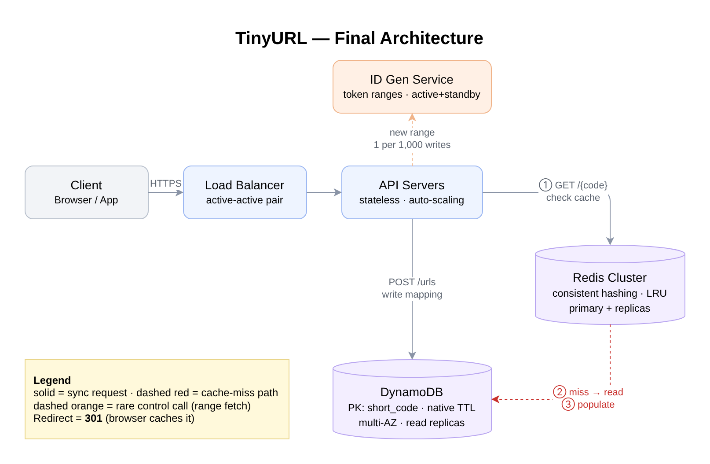
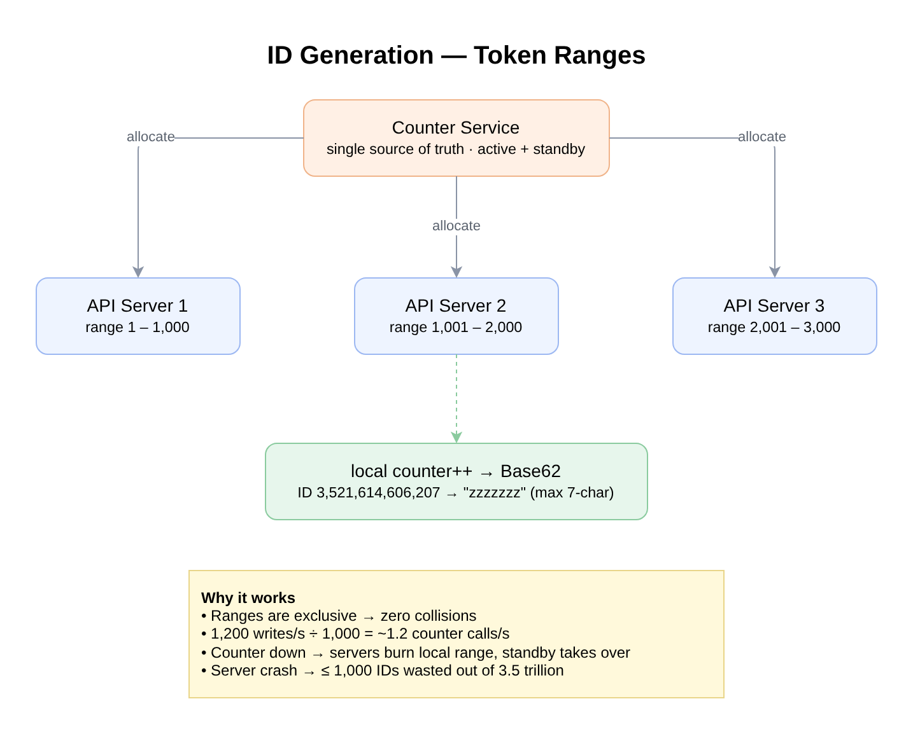

# 🔗 TinyURL — Model Interview (Fast Revision)

How a strong candidate answers "Design a URL shortener", step by step. 🎙️ = interviewer, 🧑‍💻 = candidate. Callouts flag why a line works or a trap I hit in mocks.

**Budget (~40 min):** Requirements 5 · Estimation 3 · API 3 · HLD 8 · Deep dive 15 · Ops 5

---

## 1. Requirements · 3–5 min

🎙️ **Design a URL shortener like bit.ly.**

🧑‍💻 Before drawing, let me scope it.
- **Functional:** create a short URL from a long one; redirect short → long.
- **Scope questions:** Do URLs expire? Custom aliases? Analytics? User accounts?

🎙️ **5-year expiry. No aliases, analytics or accounts. 100M new URLs/day.**

🧑‍💻 Then for non-functional:
- Read-heavy — a link is created once, clicked many times. I'll assume **100:1 read:write**.
- **p99 redirect < 100 ms**, **99.99% availability** — a dead short link breaks every page embedding it.
- **Eventual consistency is fine** — a new link being unreadable for a few hundred ms is acceptable.

> [!IMPORTANT]
> Never say "high availability / low latency" without a number. **State** assumptions ("I'll target 99.99% — OK?"), don't ask permission ("Can we have 99.9%?").

> [!WARNING]
> Mock traps: moved to estimation without asking scale; guessed **3:1** read:write.

---

## 2. Capacity estimation · 2–3 min

🧑‍💻
| | Math | Result | So what |
|---|---|---|---|
| Writes | 100M ÷ 86,400 | **~1,200/s** | — |
| Reads | × 100 | **~120,000/s** | Can't hit DB directly → **cache** |
| URLs alive | 100M × 365 × 5 | **~180 B** | Need a big ID space |
| Code length | 62⁶ ≈ 57 B ✗ · 62⁷ ≈ **3.5 T** ✓ | **7-char Base62** | — |
| Storage | 180 B × ~500 bytes | **~90 TB** | Horizontally scalable store |
| Cache | 20% of last month (3 B) × 500 B | **~300 GB** | Modest Redis cluster |

At 99% cache hits, only ~1,200 reads/s reach the DB.

> [!TIP]
> Every number must justify a decision — the "so what" column is the point of estimation.

> [!WARNING]
> Mock traps: said **500 KB** (it's bytes); wrote **12,00,00** (say **120,000**); stopped at writes/s without deriving reads/s.

---

## 3. API · 2–3 min

🧑‍💻 Create is a write → `POST`. Redirect is a read → `GET`.

```http
POST /urls   { "long_url": "https://..." }
  → 201 { "short_url": "https://tiny.url/aB3xK9z" }  | 400 bad URL | 429 rate limited

GET /{code}
  → 301 Location: <long_url>                         | 404 unknown/expired
```

🧑‍💻 **301, not 302:** the mapping never changes, so the browser caches the redirect and repeat clicks never reach us. 302 only if we needed per-click analytics.

> [!IMPORTANT]
> Full API = method + path + request + response + status codes.

> [!WARNING]
> Mock traps: used `GET /get_short` for a write; said "301 because permanent" without the *consequence* (browser caching → load drop).

---

## 4. High-level design · 5–8 min

🧑‍💻 *(narrating while drawing)*
- **Client → Load Balancer** (active-active pair, no SPOF) → **stateless API servers** (any server takes any request; auto-scale).
- **Write:** take next ID from the server's local range → Base62 → write `code → long_url` with 5-yr TTL to **DynamoDB** → 201.
- **Read (cache-aside):** check **Redis** → hit: 301 in ~1 ms → miss: read DynamoDB, populate Redis, 301.
- **ID Gen Service** only hands out ID ranges — contacted ~once per 1,000 writes.



> [!TIP]
> Narrate **what each box is and why it's there**. Writes skip the cache — a new link may never be clicked.

> [!WARNING]
> Mock traps: no API-server tier (LB → endpoints); a floating "generate short" box with no explanation; went silent while drawing.

---

## 5. Deep dive — ID generation

🎙️ **How do you generate codes without two servers colliding?**

🧑‍💻 Unique integer → Base62, not hashing (truncated hashes collide; resolving that costs a DB read per write). A single global counter per write would be a bottleneck, so **token ranges**:
- One counter service gives each server an exclusive block: S1 = 1–1,000, S2 = 1,001–2,000 …
- Servers increment **locally**; ask for a new block only when exhausted → ~**1.2 counter calls/s** total.
- Counter down → servers keep issuing from held ranges; only new ranges block.
- Counter runs **active + standby** — never active-active (two allocators would recreate collisions).
- Server crash → ≤ 1,000 IDs lost out of 3.5 T. Fine.



> [!WARNING]
> Mock traps: proposed **SHA-256 "incremented"**; "multiple counters referencing one counter" (still one bottleneck); said each *counter* holds a range (it's each **server**).

> [!NOTE]
> Alternative: **Snowflake** — timestamp + machine ID + sequence, no coordinator, needs clock sync.

---

## 6. Deep dive — database

🎙️ **Which DB and why?**

🧑‍💻 Every query is a **single-key lookup by `short_code`** — no joins, no range scans, no transactions — and I need horizontal scale for 90 TB. So **DynamoDB**: PK `short_code` (O(1) reads), multi-AZ, and **native TTL** handles 5-yr expiry with zero cleanup jobs. Trade-off: no ad-hoc queries — not needed.

```text
url_mappings:  short_code (PK) | long_url | created_at | ttl (= created_at + 5y)
```

🎙️ **Same long URL twice — same code?**

🧑‍💻 No. Dedup needs a secondary index on `long_url` across 180 B rows — costly to save a few bytes.

🎙️ **How does expiry work?**

🧑‍💻 TTL set at write. DynamoDB deletes expired items in the background, usually within 48 h; the app also checks `ttl` on read and returns 404. Redis entries carry the same TTL.

> [!TIP]
> Decision template: *"I chose X because [access pattern]. Trade-off is [Y], but requirements don't need [Z]."*

> [!WARNING]
> Mock trap: opened with **MySQL "because it's straightforward"** — not a reason.

---

## 7. Deep dive — cache

🧑‍💻
- **Redis Cluster** (over Memcached: replication, auto-failover built in).
- **Cache-aside**, **LRU** eviction, TTL ≤ link's remaining life.
- **Consistent hashing** routes each code to a fixed node; losing/adding a node remaps ~1/N keys, not nearly all (as `hash % N` would).
- Each shard = **primary + replicas**; replica promoted on failure.

🎙️ **Viral link's entry expires; 50K requests hit in one second?**

🧑‍💻 Cache stampede. **Per-key lock** — first request rebuilds, the rest wait and read it. Plus **TTL jitter** so hot keys don't expire together.

> [!WARNING]
> Mock traps: said **master/slave** (→ primary/replica); knew consistent hashing but didn't apply it to cache routing until prompted; never named "cache-aside".

---

## 8. Failures — volunteer these unprompted

| Component | Failure | Mitigation |
|---|---|---|
| Load balancer | Instance dies | Active-active pair |
| API server | Instance dies | Stateless → LB routes around; auto-scale replaces |
| Counter service | Primary down | Held ranges keep working; standby promotes |
| Redis node | Primary dies | Replica promoted; only ~1/N keys miss → DB |
| DynamoDB | Slow/throttled | Cache serves 99%+; **timeouts + circuit breaker** on DB calls |
| AZ | Zone outage | Everything spread across ≥ 2 AZs |

Retries: exponential backoff + jitter, idempotent reads only.

> [!TIP]
> "Let me walk the failure modes" — said *before* being asked — is one of the strongest lines in the interview.

---

## 9. Scaling to 10× (1.2M reads/s)

🎙️ **What breaks first?**

🧑‍💻 Servers: stateless, add more. Writes: 12K/s, DynamoDB is fine (raise range size to 10K). **Real bottleneck: cache misses** — 1% of 1.2M = **12,000 DB reads/s**. Cheapest fix first:
1. **More cache memory** → hit rate 99% → 99.9% → DB reads drop to **1,200/s**.
2. **More Redis shards/replicas** for raw read throughput.
3. **DynamoDB read capacity / DAX** last.

> [!IMPORTANT]
> **Identify → quantify → fix, cheapest first.** "Add servers and replicas" is the weak answer.

> [!WARNING]
> Mock traps: "scale the cache" (vague); jumped to Redis replicas → DB replicas, skipping bigger cache.

---

## 10. Operational excellence · 3–5 min

🧑‍💻 "Let me cover how we'd run this in production."

| SLI | Target | Alert |
|---|---|---|
| p99 redirect latency | < 100 ms | > 50 ms |
| Cache hit rate | > 99% | < 98% |
| 5xx rate | < 0.1% | > 0.1% for 5 min |
| DynamoDB read capacity | — | > 80% |

Trace ID per request · centralised logs · per-component dashboards.
**Runbook — hit rate < 98%:** check Redis for a failed node → confirm replica promotion → watch DynamoDB capacity settle as the node warms → raise capacity temporarily if near limit.

> [!WARNING]
> Mock trap: "monitor each step, act at 90%" — too generic. Name metrics, thresholds, one runbook.

---

## 11. Close

🧑‍💻 v2 items: if analytics returns → switch to 302 + publish click events to Kafka for async aggregation; add per-IP rate limiting at the gateway and malware scanning of submitted URLs.

---

## ⚡ 60-second recap

```text
Client → LB (active-active) → stateless API servers
  WRITE POST /urls  : local range ID → Base62(7) → DynamoDB (ttl 5y) → 201
  READ  GET /{code} : consistent-hash → Redis → HIT 301 (~1ms) | MISS → DynamoDB → populate → 301

Numbers  1,200 w/s · 120K r/s · 180B URLs · 90 TB · 62^7 = 3.5T · cache ~300 GB
ID gen   one counter (active+standby) → exclusive range per server → ~1.2 calls/s
Cache    cache-aside · LRU · consistent hashing · primary+replicas · stampede lock
10x      12K misses/s → bigger cache → more shards → DB capacity last
Ops      p99 < 100ms · hit > 99% · 5xx < 0.1% · trace IDs · runbook
```

<sub>Editable diagram sources: [`tinyurl_architecture.drawio`](diagrams/tinyurl_architecture.drawio) · [`tinyurl_id_generation.drawio`](diagrams/tinyurl_id_generation.drawio)</sub>
