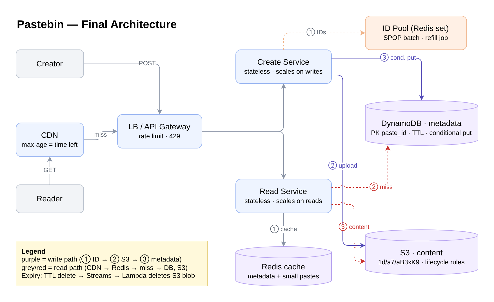
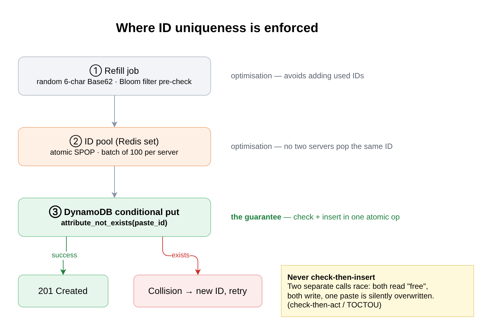

# 📋 Pastebin — Model Interview (Fast Revision)

How a strong candidate answers "Design Pastebin", step by step. 🎙️ = interviewer, 🧑‍💻 = candidate. Callouts flag why a line works or a trap I hit in the mock.

**Budget (~40 min):** Requirements 5 · Estimation 3 · API 3 · HLD 8 · Deep dive 15 · Ops 5

---

## 1. Requirements · 3–5 min

🎙️ **Design Pastebin: users paste text, get a unique URL, anyone with the URL can view it.**

🧑‍💻 Functional, as I understand it:
- Create a paste → get a unique URL; anyone with the URL can read it.
- Pastes are **immutable** once created.
- The creator picks an **expiry**: 1 hour to 5 years.

Scope questions: **max paste size?** Accounts or anonymous? Custom URLs? Public vs unlisted? Analytics?

🎙️ **Anonymous, auto-generated URLs only, no analytics. Pastes average ~10 KB, hard cap 10 MB.**

🧑‍💻 Non-functional:
- **5M new pastes/day**, read-heavy at **10:1** → 50M reads/day.
- **p99 read < 200 ms** — it's one lookup plus a blob fetch, and most reads hit a CDN.
- **99.9% availability**; **eventual consistency is fine** — a new paste unreadable for a moment is acceptable.

> [!IMPORTANT]
> **Paste size is the question that shapes the whole design.** 10 KB–10 MB blobs don't belong in a database row — that answer is what leads to "metadata in a DB, content in object storage".

> [!WARNING]
> Mock traps: never asked paste size or consistency; set **500 ms** p99 (too loose to defend); asked "**Should I** add analytics?" — decide and confirm instead: "I'll keep analytics out of scope, OK?"

---

## 2. Capacity estimation · 2–3 min

🧑‍💻 Worst case first — every paste kept the full 5 years:

| | Math | Result | So what |
|---|---|---|---|
| Writes | 5M ÷ 86,400 | **~58/s avg, ~300/s peak** (5×) | Modest — one write service fleet |
| Reads | × 10 | **~580/s avg, ~3,000/s peak** | Read-heavy → CDN + cache |
| Pastes alive | 5M × 365 × 5 | **~9 B** (upper bound) | Most expire much sooner |
| Content | 9 B × 10 KB | **~90 TB** | Object storage (S3), not a DB |
| Metadata | 9 B × ~200 B | **~2 TB** | Horizontally scalable KV store |
| ID length | 62⁶ ≈ **57 B** | **6-char Base62** | ~6× headroom; 7 chars if growth expected |
| Read bandwidth | 3,000 × 10 KB | **~30 MB/s** | Not the bottleneck |

The real CDN argument isn't bandwidth: **pastes are immutable**, so the CDN can cache each one until it expires and never invalidate.

> [!TIP]
> Say "**upper bound**" out loud. It shows you know the assumption is pessimistic, and every row ends in a decision.

> [!WARNING]
> Mock traps: used **1 KB** metadata (real ~200 B) without saying "rounding up"; justified the CDN by 30 MB/s bandwidth; opened with "let me know if I can do an estimate" — just do it.

---

## 3. API · 2–3 min

🧑‍💻 The client deals only in content and expiry; the server owns IDs, timestamps and storage.

```http
POST /api/pastes   { "content": "...", "expires_in": "1d" }       ← 1h … 5y
  → 201 { "paste_id": "aB3xK9", "url": "https://paste.bin/aB3xK9", "expires_at": "..." }
  → 400 invalid expiry · 413 content > 10 MB · 429 rate limited

GET /api/pastes/{paste_id}
  → 200 { "content": "...", "created_at": "...", "expires_at": "..." }
  → 404 unknown · 410 Gone (expired)
```

For large pastes, the server can hand back an **S3 pre-signed URL** so the client uploads straight to S3 and the API fleet never carries 10 MB bodies.

> [!WARNING]
> Mock traps: first draft had the **client sending `s3_path` and `creation_time`**, and GET **returning the S3 path** — internal storage leaked into the contract. Error codes needed two prompts.

---

## 4. High-level design · 5–8 min

🧑‍💻 *(narrating while drawing)*
- **Two services, not one:** Create and Read are separate stateless fleets — traffic is 10:1, so they scale independently.
- **Write:** Creator → LB/gateway (rate limit, 429) → Create service → ① take ID from pool → ② upload content to **S3** → ③ **conditional put** of metadata in **DynamoDB** → 201. S3 *before* metadata, so no reader ever sees metadata pointing at a missing blob.
- **Read:** Reader → **CDN** (≥80% hits) → LB → Read service → **Redis** → on miss **DynamoDB** (cache-aside, repopulate Redis) → check `expires_at` → content from Redis (small pastes) or S3.
- Funnel: **3,000 reads/s → ~600 reach the read service → ~30/s reach DynamoDB.**



> [!TIP]
> Arrows mean "who calls whom". The *service* calls DynamoDB and S3 — never draw DB → S3 or Redis → DB unless you mean it.

> [!WARNING]
> Mock traps: diagram routed **creators through the CDN** while narration said they skip it; the read side stayed blank for ~10 minutes; arrows implied Redis fetches from DB and DB fetches from S3.

---

## 5. Deep dive — ID generation & uniqueness

🧑‍💻 A **Key Generation Service**: a refill job creates random 6-char Base62 IDs into a Redis set (the pool), topping it up when it falls below 1M. Create servers `SPOP` a **batch of ~100** IDs and hand them out from memory. Random IDs also mean **no enumeration** — nobody can walk sequential IDs to scrape pastes.

🎙️ **What if a bad refill hands out an ID that a live paste already uses?**

🧑‍💻 Uniqueness is enforced at the **source of truth**, not the pool. The metadata write is a **conditional put** — `attribute_not_exists(paste_id)` — so check-and-insert is one atomic operation. If it fails, take another ID and retry. The Bloom filter in the refill job and atomic `SPOP` are optimisations on top.

If Redis crashes: the pool only holds *unused* IDs, so nothing that matters is lost — refill it. Primary + replica with AOF for fast recovery.



> [!IMPORTANT]
> **"What guarantees X?" → answer with the source of truth first, optimisations second.** Never check-then-insert as two calls — two writers can both see "free" and both write.

> [!WARNING]
> Mock traps (needed 3 nudges): proposed a **3-tier backup pool** (fixes availability, not duplicates); a **Bloom filter** as the guarantee; then **read-then-insert**, which races. Also said "security warning" for an ops alert.

---

## 6. Deep dive — database

🎙️ **Which DB, and why?**

🧑‍💻 Metadata access is a **single-key lookup by `paste_id`** — no joins, no range queries — over up to ~9B rows, so I want horizontal partitioning without hand-sharding. **DynamoDB**: partition key `paste_id`, single-digit-ms reads, conditional writes, and **per-item TTL**, which matches our creator-chosen expiry directly. Trade-off: no ad-hoc queries, which we don't need.

```text
pastes:  paste_id (PK) | s3_key | size | created_at | expires_at (TTL attribute)
```

> [!WARNING]
> Mock traps: opened with **PostgreSQL** unjustified; then "DynamoDB **provides that feature**" (Postgres has PK constraints too); then "the data is quite structured" (an argument *for* SQL). Lead with the access pattern.

---

## 7. Deep dive — caching & expiry

🧑‍💻 **Caches:** CDN `max-age` and Redis TTL = **`expires_at − now`** (remaining life, not the original TTL). Redis holds metadata plus content for small pastes (<~100 KB); big pastes stream from S3/CDN.

🎙️ **A 1-hour paste, 2 hours later — what happens everywhere?**

🧑‍💻
| Layer | What happens |
|---|---|
| CDN / Redis | Entries already expired via remaining-life TTL |
| Read path | Service checks `expires_at < now` → **410 Gone** |
| DynamoDB | TTL deletes the item lazily (usually within 48 h) → afterwards **404** |
| S3 | **Streams → Lambda** deletes the blob on TTL delete, or **lifecycle rules** per expiry prefix (`1h/`, `1d/`…; 1-day granularity) |
| Orphans | Nightly sweeper removes blobs whose metadata write failed |

The blob can outlive the paste briefly — **metadata gates access**, so it's unreachable.

> [!TIP]
> When data lives in two stores, design expiry and deletion for **both**.

> [!WARNING]
> Mock traps: started the read path at Redis, skipping the CDN; never said what Redis caches; said caches use "the same TTL as the data"; **missed S3 cleanup entirely** until asked.

---

## 8. Failures — volunteer these unprompted

| Component | Failure | Mitigation |
|---|---|---|
| Create / Read service | Instance dies | Stateless → LB routes around; auto-scale |
| ID pool (Redis) | Node down | Primary + replica, AOF; servers keep their local batch |
| Redis cache | Node down | Replica promoted; misses fall to DynamoDB (~30/s → more, still fine) |
| DynamoDB / S3 slow | Throttling, latency | Timeouts + circuit breaker; CDN keeps serving cached pastes |
| Partial write | S3 ok, metadata failed | Client gets 5xx; sweeper deletes the orphan |

> [!TIP]
> "Let me walk the failure modes" before being asked is free signal. In the mock I never did.

---

## 9. Scaling to 10× (30,000 reads/s · 3,000 writes/s)

🎙️ **What breaks first?**

🧑‍💻 **Reads:** CDN 80% → 6,000/s to read service (add instances) → Redis 95% → 300/s to DynamoDB (fine). Cheapest lever: immutable content → cache to expiry → CDN 80% → 95% cuts origin load 4× (6,000 → 1,500/s).

**Writes — the real limit is S3:** ~**3,500 PUT/s per prefix**. Expiry prefixes (`1h/`, `1d/`…) concentrate writes on a few prefixes → throttling. **Fix:** hash-prefix keys, `1d/a7/aB3xK9`. ID pool: batching cuts 3,000 `SPOP`/s to ~30/s. DynamoDB: random keys spread evenly, no hot partition.

**Hot paste:** CDN absorbs it; replicate the hot Redis key or cache it in-process.

> [!IMPORTANT]
> **Identify → quantify → fix, cheapest first** — layer by layer, with numbers.

> [!WARNING]
> Mock trap: "we need **backups so they auto-scale**" — no bottleneck, no numbers, and backups add redundancy, not capacity. Same gap as TinyURL.

---

## 10. Operational excellence · 3–5 min

🧑‍💻 "Let me cover how we'd run this in production."

| SLI | Target | Alert |
|---|---|---|
| p99 read latency | < 200 ms | > 150 ms |
| CDN hit rate | > 80% | < 70% |
| Redis hit rate | > 95% | < 90% |
| 5xx rate | < 0.1% | > 0.1% for 5 min |
| S3 503 SlowDown | ~0 | any sustained |
| ID pool depth | > 1M | < 1M (refill lagging) |

Trace ID per request · centralised logs · per-service dashboards.
**Runbook — pool depth < 1M:** check the refill job → restart / scale it → confirm servers still hold local batches → watch create-service error rate.

---

## 11. Close

🎙️ **Anything else?**

🧑‍💻 Two v2 items: **abuse** — rate limit per IP at the gateway, size caps, and scanning pastes for malware/credential leaks; **private pastes** — an optional password or delete-token returned at creation.

> [!WARNING]
> Mock trap: answered "**nothing much**" — and gave away the last chance to cover failures and ops. Never pass on "anything else?".

---

## ⚡ 60-second recap

```text
WRITE  Creator → LB (429) → Create svc → ID batch (SPOP) → S3 (hash-prefixed key)
                         → DynamoDB conditional put (attribute_not_exists) → 201
READ   Reader → CDN (≥80%) → LB → Read svc → Redis (95%) → DynamoDB → check expires_at
                         → content from Redis (small) / S3-CDN (large) → 200 | 410 | 404

Numbers  58 w/s avg · 300 peak · 3,000 r/s peak · ~9B pastes worst case · 90 TB S3 · ~2 TB metadata
IDs      random 6-char Base62 (57B) · pool + refill · uniqueness = DB conditional put · no enumeration
Expiry   cache TTL = time left · 410 then 404 · Streams→Lambda / lifecycle deletes S3 · orphan sweeper
10x      CDN hit rate first · S3 3,500 PUT/s per prefix → hash prefixes · batch SPOP
Ops      p99 < 200ms · CDN/Redis hit · 5xx · S3 throttles · pool depth < 1M alert
```

<sub>Editable diagram sources: [`pastebin_architecture.drawio`](diagrams/pastebin_architecture.drawio) · [`pastebin_uniqueness.drawio`](diagrams/pastebin_uniqueness.drawio)</sub>
